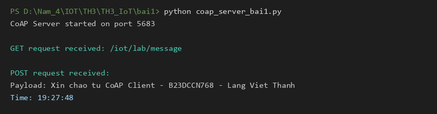
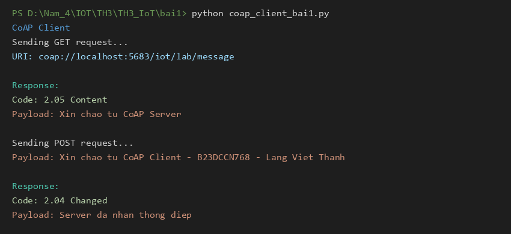
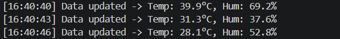
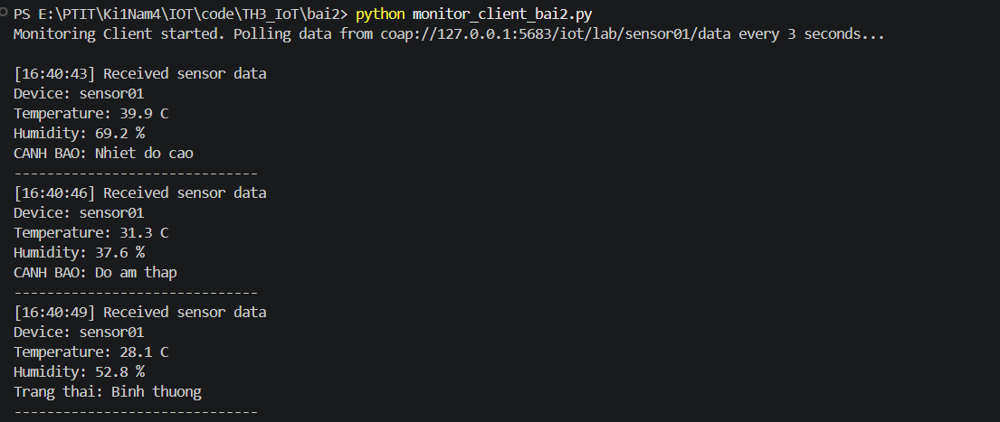
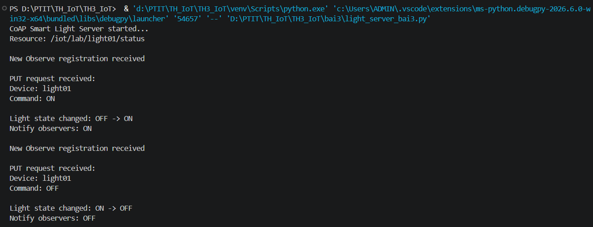
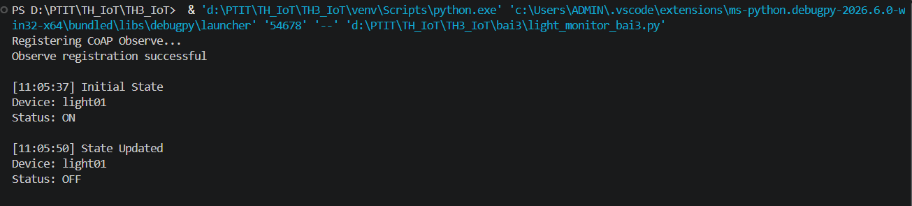
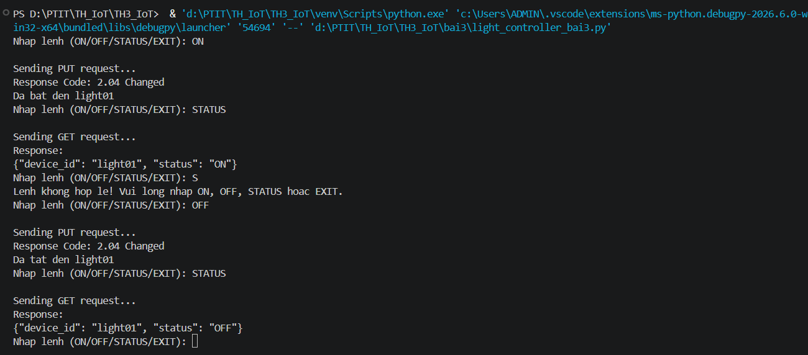

# THỰC HÀNH: LẬP TRÌNH PYTHON VỚI GIAO THỨC CoAP

## 1. Thông tin nhóm thực hiện
* **Bài 1:** Lăng Viết Thành - B23DCCN768
* **Bài 2:** Nguyễn Viết Hải - B23DCCN278
* **Bài 3:** Trương Minh Sơn - B23DCCN726

## 2. Môi trường và Thư viện sử dụng
* **Ngôn ngữ lập trình:** Python 3.x
* **Thư viện chính:** 
  * `aiocoap` (Hỗ trợ xây dựng CoAP Server, Client và cơ chế Observe)
  * Các thư viện chuẩn tích hợp sẵn: `asyncio`, `json`, `datetime`

## 3. Cài đặt môi trường
Thực hiện các bước sau trong Terminal (PowerShell hoặc Bash) của VS Code:

1. Kích hoạt môi trường ảo:
```
.\.venv\Scripts\Activate.ps1
```
2. Cài đặt thư viện aiocoap:
```
pip install aiocoap
```
3. Cấu hình mạng & URI tài nguyên CoAP
- Giao thức: CoAP
- Địa chỉ IP Server (chạy nội bộ): 127.0.0.1 (localhost)
- Cổng (Port): 5683 (Cổng mặc định của CoAP)
- URI tài nguyên: 
  - coap://127.0.0.1:5683/iot/lab/message
  - coap://127.0.0.1:5683/iot/lab/sensor01/data
  - coap://127.0.0.1:5683/iot/lab/light01/status

## 4. Hướng dẫn chạy chương trình

## Bài 1. Ứng dụng gửi và nhận thông điệp CoAP cơ bản

### 1. Cách chạy chương trình: 

- Terminal 1 - Khởi chạy CoAP Server:
```
python bai1/coap_server_bai1.py
```
*(Hoặc `cd bai1` rồi chạy `python coap_server_bai1.py`)*

- Terminal 2 - Khởi chạy CoAP Client:
```
python bai1/coap_client_bai1.py
```
*(Hoặc `cd bai1` rồi chạy `python coap_client_bai1.py`)*

### 2. Kết quả đạt được:

- Terminal 1 (Server):


- Terminal 2 (Client):



## Bài 2. Mô phỏng cảm biến nhiệt độ và độ ẩm bằng CoAP

### 1. Cách chạy chương trình: 

- Terminal 1 - Khởi chạy CoAP Server:
```
python sensor_server_bai2.py
```
- Terminal 2 - Khởi chạy Monitoring Client:
```
python monitor_client_bai2.py
```

### 2. Kết quả đạt được:

- Terminal 1:


- Terminal 2:



## Bài 3. Mô phỏng hệ thống giám sát và điều khiển đèn thông minh bằng CoAP Observe

### 1. Cách chạy chương trình: 

- Terminal 1 - Khởi chạy CoAP Server:
```
python light_server_bai3.py
```
- Terminal 2 - Khởi chạy Monitoring Client:
```
python light_monitor_bai3.py
```
- Terminal 3 - Khởi chạy Controller Client:
```
python light_controller_bai3.py
```

### 2. Kết quả đạt được:

- Terminal 1:


- Terminal 2:


- Terminal 3:
